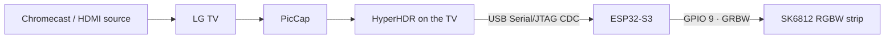

# TV LEDs

Ambient lighting for a TV using a rooted LG webOS TV, an ESP32-S3, and an
SK6812 RGBW strip. The TV captures its own picture, HyperHDR calculates the
edge colours, and the ESP32 receives them over USB and drives the LEDs.

The working setup uses an LG C9 with a Chromecast on HDMI. Capture happens
on the TV, so the player needs no modified app or screen-sharing service.
Stock Jellyfin 4K Dolby Vision playback has been tested with this path.



## What works

- Live picture capture with PicCap and colour processing with HyperHDR on the TV.
- Native ESP-IDF firmware using RMT with DMA to drive the strip.
- Automatic black-bar detection on both axes: widescreen, 4:3, and combined bars.
  Sampling follows the active picture; a subtitle-like overlay in the bottom
  bar is covered by the integration test.
- Direct colour updates without a smoothing fade at scene cuts.
- Fixed brightness scaling that preserves dark-to-light differences while
  respecting an estimated power budget.
- Firmware updates through the TV's USB port, with esptool running on the computer.
- Standalone strip tests and an optional Android app for HDMI test patterns.

This is a working personal setup, with configuration for the hardware below.
Other TV models, firmware versions, strips, and layouts need their own validation.

## Tested hardware and software

| Part | Configuration |
| --- | --- |
| TV | LG OLED65C9PLA, firmware 05.40.61, rooted webOS |
| TV software | PicCap 0.5.3 and HyperHDR 22.0.1 |
| Controller | ESP32-S3, native USB Serial/JTAG interface, GPIO 9 data output |
| Strip | 266 SK6812 RGBW pixels, approximately 60 pixels/m |
| Power | Two 5 V USB feeds; +5 V trace cut between pixels 132 and 133 |
| Firmware toolchain | ESP-IDF 5.4, C compiler, CMake/Ninja, Python |
| Management computer | Linux, Python 3, OpenSSH; Android SDK optional |

Viewed from the **front** of the TV, the first pixel is at the bottom-left.
The strip runs up the left, across the top, down the right, then across the bottom.

| Side | Pixels | Zero-based indices |
| --- | ---: | --- |
| Left | 48 | 0–47 |
| Top | 85 | 48–132 |
| Right | 47 | 133–179 |
| Bottom | 86 | 180–265 |

Connect the strip's ground to ESP32 ground. The TV USB connection powers the
controller; the external supply powers the strip. With separate power feeds,
keep ground common and isolate their +5 V sections. Do not join two supply
outputs through an uncut +5 V strip trace. The firmware's current estimate is
not a substitute for a correctly rated supply and wiring.

## Prepare the TV and local configuration

The TV must already have root SSH access, PicCap, and the HyperHDR webOS loader
installed. See [webOS Homebrew](https://www.webosbrew.org/),
[PicCap](https://github.com/webosbrew/PicCap), and
[HyperHDR](https://github.com/awawa-dev/HyperHDR) for those projects.
This repository does not automate rooting or installation of the TV packages.
The tested TV provides Python 2.7, used by the serial helpers.

Create a computer-side environment and an ignored local configuration:

```sh
python3 -m venv .venv
.venv/bin/pip install -r tools/requirements-ambient.txt
cp config/local.example.json config/local.json
```

Edit `config/local.json` with the TV address, SSH username, private-key path,
known-hosts file, and the ESP32's verified USB serial number. Relative paths
are resolved from this repository; `~` is expanded. Example values are placeholders.

Establish SSH trust interactively first, checking the TV's host key:

```sh
mkdir -p build/lg-root
ssh -i ~/.ssh/tv-leds -o IdentitiesOnly=yes \
  -o UserKnownHostsFile=build/lg-root/known_hosts root@tv.local
```

The helpers require working key authentication and pin the saved host key.
To find the board identity, inspect the TV's USB devices with `lsusb -v`
or their `serial`, `idVendor`, and `idProduct` files under `/sys/bus/usb/devices/`.
The native S3 interface used here is `303a:1001`. Match the physical board,
then set `espUsbSerial` to its actual serial number. Helpers identify that
board after every reconnect rather than assuming `/dev/ttyACM0` is stable.
HyperHDR uses the resolved native port because it rejects custom serial aliases.

The HyperHDR helper uses its default password, `hyperhdr`. If changed, set
`HYPERHDR_PASSWORD` in the environment. SSH keys, local settings, captures,
backups, build output, and debug signing keys are excluded from Git.

## Build and flash the ESP32

Install ESP-IDF and set `IDF_PATH` to its checkout. The build script loads its
environment, runs the host protocol tests with ASan/UBSan, and builds the firmware:

```sh
export IDF_PATH=/path/to/esp-idf
bash tools/build-native-leds.sh live
```

Output: `build/esp-idf-leds/tv_leds_native.bin`.

For a **new board connected to the computer**, use the generated bootloader
and partition table as well as the application. From an activated ESP-IDF shell:

```sh
idf.py -C firmware/esp-idf-leds -B build/esp-idf-leds \
  -p /dev/serial/by-id/ACTUAL_DISCOVERED_DEVICE flash
```

Choose the persistent path discovered for your board. Back up existing firmware
before replacing it. The supplied build configuration targets a 4 MiB flash
layout; adapt it for your hardware if needed.

For an **existing board attached to the TV**, whose bootloader and partition
table already place a compatible application at **0x10000**:

```sh
.venv/bin/python3 tools/ambient.py stop
.venv/bin/python3 tools/flash-esp32-through-tv.py build/esp-idf-leds/tv_leds_native.bin
.venv/bin/python3 tools/ambient.py start
```

This helper writes only the application at 0x10000. It retains the existing
bootloader, partition table, and other partitions; it does not provision a blank
board or check whether an arbitrary existing partition layout is compatible.
Esptool runs on the computer through an SSH tunnel to a temporary loopback-only
serial bridge on the TV. The USB cable stays plugged into the TV.
`ESPTOOL_PYTHON` can select another Python environment containing esptool.

The firmware has no Wi-Fi or OTA service. See the
[firmware notes](firmware/esp-idf-leds/README.md) for packet and timing details.

## Run ambient lighting

```sh
.venv/bin/python3 tools/ambient.py start
.venv/bin/python3 tools/ambient.py status
.venv/bin/python3 tools/ambient.py stop
```

`start` identifies the controller, backs up HyperHDR's configuration locally,
applies the saved layout/device settings, and starts capture and LED output.
Management requests use an SSH tunnel to HyperHDR on TV localhost port 8090.
The computer is only needed for management and flashing; it does not process
or forward the live pictures.

**C9-specific capture setting:** the helper sets PicCap's `quirks` to **1**
(`QUIRK_DILE_VT_CREATE_EX`), with 640 × 360 capture at a requested 30 fps.
Without that quirk, capture corrupted both the captured image and the actual
TV picture in our tests. Do not assume this profile suits another TV.

| File | Controls |
| --- | --- |
| `config/led-layout.json` | LED sampling regions and side counts |
| `config/ambient-device.json` | Adalight USB output settings |
| `config/ambient-blackbars.json` | Both-axis black-bar detection in `osd` mode |
| `config/ambient-smoothing.json` | Colour smoothing, disabled by default |
| `firmware/esp-idf-leds/main/protocol.h` | Current estimates, limits, feed boundary |
| `firmware/esp-idf-leds/main/main.c` | Data GPIO and standalone test pixel count |

Black-bar changes stabilize over several seconds; ordinary colour changes have
no added smoothing fade. Boot-time startup on the TV is not configured: rerun
`start` after a TV restart. Changing the strip layout requires updating its
sampling regions and the firmware's power-feed boundary/test count together.

## Brightness and power

The receiver assumes 1 mA idle per pixel and 20 mA per fully lit channel.
It applies **one fixed gain** for the pixel count and input format, chosen so
worst-case full white fits **3 A total** and **2.4 A per feed**. These are
estimates, not measurements or hardware current regulation.

For the 266-pixel RGB stream, input values map approximately as follows:

| Input channel | Output PWM |
| ---: | ---: |
| 0 | 0 |
| 16 | 2 |
| 64 | 10 |
| 128 | 21 |
| 255 | 43 |

A pixel keeps the same brightness when other pixels get brighter or darker.
Dark scenes are not automatically boosted toward the full-white power budget.
A final frame-current estimate provides a defensive ceiling.

The live pipeline sends RGB; firmware maps it to GRBW with the dedicated white
channel off. RGBW diagnostic packets are also supported. Colour/white-point
calibration and detailed latency measurements remain future work.

## Optional Chromecast remote helper

The [Remote Helper](https://github.com/floitsch/chromecast-remote-helper) maps the Netflix button
to Jellyfin and provides a configurable nighttime arrow restriction. It uses
playback state and calibrated Bluetooth proximity, runs independently of the
LED setup, and has its own settings app, build instructions, and repository.

## Diagnostics and tests

Host tests cover packet parsing, invalid checksums, bounds, RGB/RGBW order,
brightness contrast, independence from surrounding pixels, total/feed budgets,
echo packets, and binary noise. GitHub Actions runs these under ASan/UBSan.
To run them without installing ESP-IDF:

```sh
mkdir -p build
cc -std=c11 -Wall -Wextra -Werror -g -fsanitize=address,undefined \
  -I firmware/esp-idf-leds/main firmware/esp-idf-leds/main/protocol.c \
  firmware/esp-idf-leds/test/protocol-test.c -o build/protocol-test
build/protocol-test
```

For hardware diagnosis, stop ambient output and build either
`bash tools/build-native-leds.sh standalone` (green once) or
`bash tools/build-native-leds.sh standalone-repeat` (green at about 30 Hz).
Both use `build/esp-idf-leds-test/tv_leds_native.bin` and run without USB input.
Flash that test image using the same procedure above, **leaving ambient output
stopped**. Restore the `live` image and start ambient lighting when done.
Incorrect colours beginning immediately after a joint can indicate a broken
connection or pixel; these tests isolate that from TV capture.

`tools/tv-led-marker.py` sends selected RGBW markers through the normal receiver.
Stop ambient output first; for example, run the first pixel green until interrupted:

```sh
.venv/bin/python3 tools/ambient.py stop
python3 tools/tv-led-marker.py --count 266 --index 0 --color green --seconds 0
# Ctrl-C sends blackout. Restart ambient lighting when finished.
```

An optional Android TV pattern app exercises the complete HDMI capture path.
It needs a JDK, Android SDK platform 35 and build-tools 36.0.0; override
`ANDROID_HOME`, `ANDROID_PLATFORM`, or `ANDROID_BUILD_TOOLS` as needed.

```sh
bash tools/build-patterns.sh
adb -s CHROMECAST_IP:DEBUG_PORT install -r build/tv-leds-patterns.apk
adb -s CHROMECAST_IP:DEBUG_PORT shell am start \
  -n org.toit.tvleds/.PatternActivity --es mode letterbox
.venv/bin/python3 tools/test-blackbars.py CHROMECAST_IP:DEBUG_PORT
```

The eleven black-bar checks passed on the tested setup, including sidebars,
combined bars, a subtitle-like overlay, black frames, and return to full-frame
content. Results are saved locally under `build/lg-root/black-bars/`.
The suite changes displayed patterns and returns the Chromecast to its home screen.

Other useful modes: `red`, `green`, `blue`, `white`, `black`, `middle-band`,
`horizontal-colors`, `moving-band`, `pillarbox`, `windowbox`, and `fullframe-edges`.
The pattern app is a diagnostic tool, not part of normal playback.
